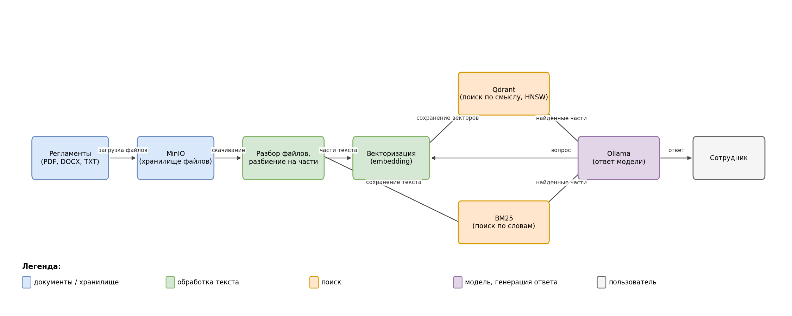

# Отчёт по практической №2

> **Как сдавать.** Репозиторий выложи на GitHub. В отчёте укажи ФИО ровно так, как в VK Education — по нему работа идентифицируется.

---

## 1. Вариант и задача

| Поле | Значение |
|---|---|
| ФИО (как в VK Education) | Vadim Nozdrin |
| Тема | 3 — RAG + векторная БД (поиск по документам) |
| Состав решения | MinIO (хранилище регламентов), rag-ingest (разбор файлов, разбиение на части, векторизация), Qdrant (векторный поиск), BM25 (поиск по словам), rag-api (объединяет оба вида поиска), Ollama (генерация ответа, модель Qwen2.5-1.5B-Instruct) |
| Данные, объём | 3 регламента компании в разных форматах: `.txt`, `.pdf`, `.docx`, по 1–2 страницы каждый. Сделал их сам, чтобы показать, что загрузка работает с разными форматами файлов |

Задача по варианту: в компании много регламентов и инструкций, сотрудники не могут быстро найти в них нужный пункт. Нужен сервис, который отвечает на вопрос по содержимому документов. Я делаю ту часть, которая готовит данные для модели (загрузка документов, разбиение на части, векторизация, поиск), саму языковую модель не обучаю и не меняю — беру готовую маленькую модель и использую её только для последнего шага, генерации текста ответа.

## 2. Источники и способы сбора

| Источник | Тип (поток / batch / CDC / документы / API) | Способ сбора |
|---|---|---|
| Регламент удалённой работы | документ, `.txt` | Файл лежит в папке `docs/`, загружается в MinIO сервисом `minio-init` |
| Регламент доступа к данным | документ, `.pdf` | Так же через MinIO, текст из PDF достаётся библиотекой `pypdf` |
| Регламент отпусков | документ, `.docx` | Так же через MinIO, текст из DOCX достаётся библиотекой `python-docx` |

Почему так: в обычной компании регламенты лежат в каком-то файловом хранилище (SharePoint, корпоративный диск и т.п.). MinIO — это открытый аналог такого хранилища, совместимый с S3, я уже работал с ним в первой практической. Документы собираются не потоком, а пакетом (batch): регламенты меняются редко, раз в день-два прогнать индексацию заново вполне достаточно, постоянно слушать поток изменений тут не нужно.

## 3. Архитектура (draw.io)



Исходник: `architecture.drawio`.

Как читать схему: документы попадают в MinIO, оттуда их забирает `rag-ingest` — разбирает файл, режет текст на части и считает для каждой части вектор (embedding). Векторы уходят в Qdrant, а сами части текста отдельно сохраняются для поиска по словам (BM25) — так ищем и по смыслу, и по точным словам/номерам пунктов сразу. Когда сотрудник присылает вопрос, он ищется и в Qdrant, и в BM25, найденные части уходят в модель Ollama, модель формирует ответ, и он возвращается сотруднику.

Легенда цветов указана под схемой. Блоков из пройденного материала на схеме пять: хранилище документов, обработка текста/векторизация, векторный поиск (Qdrant, HNSW), поиск по словам (BM25), генерация ответа моделью.

## 4. Docker — что поднялось (честно)

| Блок | Статус (реализовано / нет) |
|---|---|
| MinIO + загрузка регламентов в бакет `regulations` | реализовано |
| rag-ingest: разбор файлов (txt/pdf/docx), разбиение на части, векторизация | реализовано |
| Qdrant (векторный поиск, HNSW) | реализовано |
| BM25 (поиск по словам) | реализовано |
| Объединение результатов поиска в `rag-api` | реализовано |
| Ollama + модель Qwen2.5-1.5B-Instruct | реализовано, но не так, как планировал — см. ниже |
| Генерация ответа через `rag-api` (`/ask`) | реализовано |
| Проверка качества поиска (`/search`, вручную) | есть отдельный запрос для этого, но автоматических метрик (precision/recall) не считал |

Порог для Docker не задан, но у меня поднялся весь пайплайн целиком, все шаги работают в контейнерах, а не только нарисованы на схеме.

**Про Ollama отдельно, честно.** Модель для Ollama обычно качается командой `ollama pull` из реестра Ollama. У меня эта команда не заработала: сервер, с которого реестр отдаёт сами файлы модели, не открывался из моей сети (DNS отдавал нерабочий адрес), хотя Docker Hub и обычные сайты работали нормально. Я не стал разбираться дальше, почему так, а просто скачал файл модели (GGUF) напрямую с HuggingFace и подключил его в Ollama командой `ollama create` — по сути то же самое, только файл модели беру из другого места.

### Как запускалось

```bash
cd "Практика 2"
docker compose up -d --build
docker compose ps
```

```
NAME                 IMAGE                                      SERVICE          STATUS
2-minio-1            pgsty/silo:RELEASE.2026-09-03T13-18-01Z    minio            Up (healthy)
2-minio-init-1       pgsty/silo:RELEASE.2026-09-03T13-18-01Z    minio-init       Exited (0)
2-model-download-1   curlimages/curl:latest                     model-download   Exited (0)
2-ollama-1           ollama/ollama:latest                       ollama           Up
2-ollama-pull-1      ollama/ollama:latest                       ollama-pull      Exited (0)
2-qdrant-1           qdrant/qdrant:latest                       qdrant           Up
2-rag-api-1          2-rag-api                                  rag-api          Up
2-rag-ingest-1       2-rag-ingest                                rag-ingest       Exited (0)
```

Сервисы со статусом `Exited (0)` — это разовые задачи (загрузить документы, построить индекс, скачать и подключить модель), они должны завершиться и выключиться, это нормально, не ошибка.

Порядок запуска: `minio` → `minio-init` (кладёт документы в бакет) → `rag-ingest` (строит индекс и выключается) → отдельно `ollama` → `model-download` → `ollama-pull` (подключает модель) → когда всё готово, поднимается `rag-api` и можно слать запросы.

Лог `rag-ingest`:

```
[ingest] MinIO готов
[ingest] найдено документов в бакете regulations: 3
[ingest] загружаю модель эмбеддингов paraphrase-multilingual-MiniLM-L12-v2
[ingest] Qdrant готов
[ingest] reglament_data_access.pdf: 1359 символов -> 2 чанков
[ingest] reglament_otpuska.docx: 1010 символов -> 2 чанков
[ingest] reglament_remote_work.txt: 1198 символов -> 2 чанков
[ingest] готово: 6 чанков из 3 документов
[ingest] корпус для BM25 сохранён в /data/corpus.jsonl
```

Проверка запроса:

```bash
curl -s -X POST http://localhost:8010/ask \
  -H "Content-Type: application/json" \
  -d '{"question": "На сколько частей можно разбить отпуск?"}'
```

```json
{
  "question": "На сколько частей можно разбить отпуск?",
  "answer": "Отпуск за текущий рабочий год можно разбивать не более чем на 3 части.",
  "sources": [
    {"source": "reglament_otpuska.docx", "chunk_index": 0},
    {"source": "reglament_remote_work.txt", "chunk_index": 0},
    {"source": "reglament_remote_work.txt", "chunk_index": 1},
    {"source": "reglament_otpuska.docx", "chunk_index": 1},
    {"source": "reglament_data_access.pdf", "chunk_index": 0}
  ]
}
```

Ответ совпадает с пунктом 2.3 регламента отпусков и правильно указывает документ-источник первым в списке.

## 5. Описание

| Шаг | Для чего | Результат |
|---|---|---|
| 1. Загрузка | Забрать регламенты из хранилища (MinIO) | Файлы PDF/DOCX/TXT у `rag-ingest` |
| 2. Разбор файла | Достать обычный текст из PDF/DOCX/TXT | Текст документа |
| 3. Разбиение на части | Разрезать текст на куски примерно по 120 слов с небольшим перекрытием, чтобы не обрезать мысль посередине | Набор частей текста с привязкой к файлу-источнику |
| 4. Векторизация | Посчитать для каждой части вектор (embedding), модель многоязычная, так как регламенты на русском | Векторы |
| 5. Сохранение | Векторы — в Qdrant, тексты частей — отдельно, для поиска по словам (BM25) | Готовый индекс для поиска |
| 6. Вопрос | Сотрудник присылает вопрос в `rag-api` | Текст вопроса |
| 7. Поиск | Вопрос ищется в Qdrant (по смыслу) и в BM25 (по словам), оба списка результатов объединяются в один | Несколько самых подходящих частей текста |
| 8. Генерация | Найденные части вместе с вопросом отправляются в Ollama с просьбой отвечать только по этим частям | Текст ответа |
| 9. Ответ | `rag-api` отдаёт ответ и список источников (файл и номер части) | Ответ сотруднику со ссылкой на регламент |

### Как оценивал качество поиска

Отдельных метрик вроде precision или recall я не считал — для этого нужен готовый набор вопросов с правильными ответами, а это отдельная работа. Проверял руками: задавал вопрос через `/search` и смотрел, какие части текста находятся в топе и из какого они файла. Там же видно, нашёл ли эту часть поиск по смыслу, поиск по словам или оба сразу. На моих трёх документах результат выглядит правильным, но для реальных тысяч документов такой ручной проверки, конечно, мало.

### Что тут работа data engineer, а что нет

Моя часть — всё до генерации ответа: откуда брать документы, как часто их переиндексировать, как доставать текст из разных форматов, как резать на части, какую модель эмбеддингов использовать и где хранить векторы, как сочетать поиск по смыслу и по словам. Саму языковую модель, которая пишет ответ, я не обучаю и не настраиваю — беру готовую и подаю ей на вход то, что нашёл поиском.

## 6. Выводы

Основная часть работы в RAG — это не сама модель, а то, что до неё: как правильно порезать документы на части и какой поиск использовать. Если резать текст слишком крупно или слишком мелко, часть смысла теряется. Поиск только по смыслу (векторный) иногда не находит точные формулировки — номера пунктов, сроки, конкретные цифры, поэтому рядом добавлен обычный поиск по словам.

Отдельно столкнулся с тем, что реестр моделей Ollama был недоступен из моей сети, хотя остальное (Docker Hub, PyPI) работало нормально. Решил проблему так: скачал файл модели напрямую из другого источника и подключил его в Ollama вручную. На результат это не повлияло, просто пришлось потратить время на поиск причины.

**Мой любимый десерт** — тирамису.
